# Actividad 8 · Los cuatro retos

**Materia:** Desarrollo de Aplicaciones Móviles 2026  ·  **Docente:** Anastacio Rodríguez García  ·  **Alumno:** Cristopher Gerardo Villanueva Ramírez

Cuatro apps en Flutter, cada una con una **idea original** que cumple el reto correspondiente. Todas siguen una estructura por *features* con las capas `data / domain / presentation` (Clean Architecture, actividades 9 y 10).

| Reto | App | API | Pruebas |
|---|---|---|---|
| Reto 1 | [PeliVoto 🍿](#peli_voto) | The Movie Database (TMDB) | ✅ 6/6 |
| Reto 2 | [MichiPostal 🐱](#michi_postal) | Cataas (Cats as a Service) | ✅ 7/7 |
| Reto 3 | [¿Salgo o no? ☁️](#salgo_o_no) | OpenWeatherMap + geolocator | ✅ 7/7 |
| Reto 4 | [Alcancía Cripto 🐷](#alcancia_cripto) | CoinGecko | ✅ 7/7 |

**Total: 27 pruebas, todas pasan ✅** — evidencia generada con `flutter test -r expanded` (Flutter 3.47.2, Dart 3.13.2).

Las capturas se tomaron con las apps **ejecutándose en el emulador Android “Medium Phone”** (1080×2400) en mi laptop, usando datos reales de cada API.

## Índice

- [Reto 1 · PeliVoto 🍿](#peli_voto)
- [Reto 2 · MichiPostal 🐱](#michi_postal)
- [Reto 3 · ¿Salgo o no? ☁️](#salgo_o_no)
- [Reto 4 · Alcancía Cripto 🐷](#alcancia_cripto)
- [Cómo ejecutar](#como-ejecutar)

<a id="peli_voto"></a>

## Reto 1 · PeliVoto 🍿

**API:** The Movie Database (TMDB)  ·  **Carpeta:** [`peli_voto/`](peli_voto/)

Noche de película **en grupo**: cada amigo vota su estado de ánimo, la app junta los géneros, ordena las películas según **a cuántos del grupo dejan contentos** y permite *vetar* hasta que haya acuerdo. Incluye pestaña de tendencias de la semana.

### 📱 Capturas en el emulador

| Pantalla inicial: cada amigo elige su estado de ánimo | Tres votos registrados (Ana 😂, Eva 👻, Luis 🔥) | Película propuesta con datos reales de TMDB y medidor “le late a 2 de 3” | Al aceptar: diálogo de película decidida | Pestaña de tendencias de la semana |
|---|---|---|---|---|
| 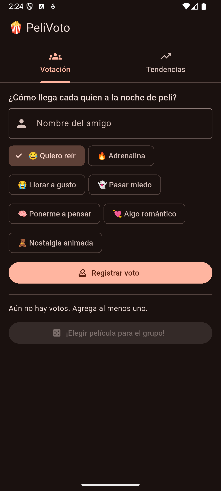 | 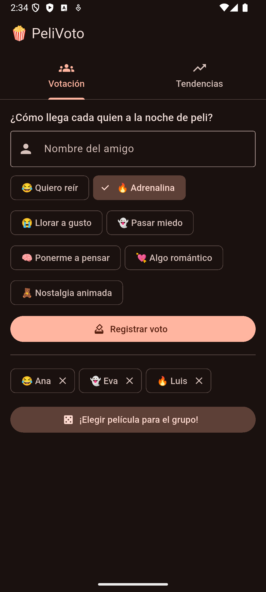 | 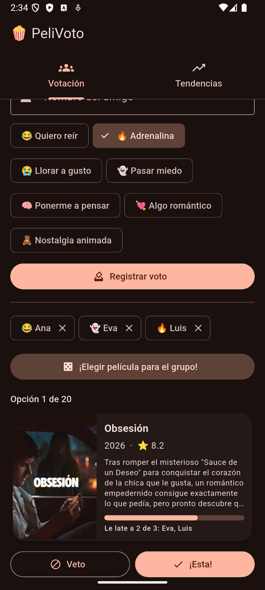 | 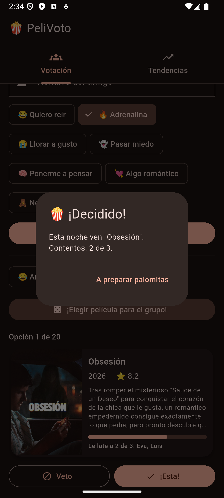 | 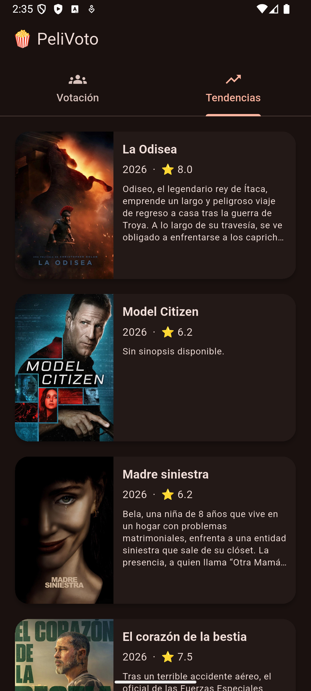 |

### 🧪 Pruebas (`flutter test`)

Archivo: [`peli_voto/test/widget_test.dart`](peli_voto/test/widget_test.dart). Las pruebas usan **repositorios falsos** (sin internet) gracias a la inversión de dependencias.

#### Prueba 1: primero va la pelicula que deja contentos a mas votantes

*Prueba unitaria · grupo: **ElegirPeliculaGrupal (caso de uso)***

```dart
test('primero va la pelicula que deja contentos a mas votantes', () async {
  final res = await ElegirPeliculaGrupal(repo)(const [
    Voto('Ana', EstadoAnimo.risas),
    Voto('Luis', EstadoAnimo.risas),
    Voto('Eva', EstadoAnimo.miedo),
  ]);
  expect(res.first.pelicula.titulo, 'Comedia de terror');
  expect(res.first.satisfechos, 3);
  expect(res.first.nombresSatisfechos, ['Ana', 'Luis', 'Eva']);
});
```

**Salida de `flutter test`:**

```text
00:00 +0: ElegirPeliculaGrupal (caso de uso) primero va la pelicula que deja contentos a mas votantes
✅ PASÓ
```

#### Prueba 2: a empate de votos gana la mejor calificada

*Prueba unitaria · grupo: **ElegirPeliculaGrupal (caso de uso)***

```dart
test('a empate de votos gana la mejor calificada', () async {
  final res = await ElegirPeliculaGrupal(repo)(const [Voto('Ana', EstadoAnimo.miedo)]);
  // "Terror" (9.0) y "Comedia de terror" (6.0) satisfacen a 1 persona
  expect(res[0].pelicula.titulo, 'Terror');
  expect(res[1].pelicula.titulo, 'Comedia de terror');
});
```

**Salida de `flutter test`:**

```text
00:00 +1: ElegirPeliculaGrupal (caso de uso) a empate de votos gana la mejor calificada
✅ PASÓ
```

#### Prueba 3: sin votos no se consulta nada y regresa lista vacia

*Prueba unitaria · grupo: **ElegirPeliculaGrupal (caso de uso)***

```dart
test('sin votos no se consulta nada y regresa lista vacia', () async {
  expect(await ElegirPeliculaGrupal(repo)(const []), isEmpty);
});
```

**Salida de `flutter test`:**

```text
00:00 +2: ElegirPeliculaGrupal (caso de uso) sin votos no se consulta nada y regresa lista vacia
✅ PASÓ
```

#### Prueba 4: lee el JSON de TMDB y rellena lo que falta

*Prueba unitaria · grupo: **PeliculaModel (capa de datos)***

```dart
test('lee el JSON de TMDB y rellena lo que falta', () {
  final m = PeliculaModel.fromJson({
    'id': 99,
    'title': 'Coco',
    'overview': '',
    'poster_path': null,
    'vote_average': 8.2,
    'release_date': '2017-10-27',
    'genre_ids': [16, 10751],
  });
  expect(m.titulo, 'Coco');
  expect(m.anio, '2017');
  expect(m.sinopsis, 'Sin sinopsis disponible.');
  expect(m.posterUrl, isNull);
  expect(m.generos, [16, 10751]);
});
```

**Salida de `flutter test`:**

```text
00:00 +3: PeliculaModel (capa de datos) lee el JSON de TMDB y rellena lo que falta
✅ PASÓ
```

#### Prueba 5: arma la URL completa del poster

*Prueba unitaria · grupo: **PeliculaModel (capa de datos)***

```dart
test('arma la URL completa del poster', () {
  final m = PeliculaModel.fromJson({'id': 1, 'title': 'X', 'poster_path': '/abc.jpg'});
  expect(m.posterUrl, 'https://image.tmdb.org/t/p/w500/abc.jpg');
});
```

**Salida de `flutter test`:**

```text
00:00 +4: PeliculaModel (capa de datos) arma la URL completa del poster
✅ PASÓ
```

#### Prueba 6: registrar un voto y elegir muestra la pelicula ganadora

*Prueba de widget (pantalla) · grupo: **VotacionPage (pantalla)***

```dart
testWidgets('registrar un voto y elegir muestra la pelicula ganadora', (tester) async {
  tester.view.physicalSize = const Size(1080, 2400);
  tester.view.devicePixelRatio = 1.0;
  addTearDown(tester.view.reset);

  final elegir = ElegirPeliculaGrupal(RepoFalso([peli(2, 'Comedia', [35], 7.0)]));
  await tester.pumpWidget(MaterialApp(home: Scaffold(body: VotacionPage(elegir: elegir))));

  await tester.enterText(find.byType(TextField), 'Ana');
  await tester.tap(find.text('Registrar voto'));
  await tester.pump();
  expect(find.text('😂 Ana'), findsOneWidget);

  await tester.tap(find.text('¡Elegir película para el grupo!'));
  await tester.pumpAndSettle();
  expect(find.text('Comedia'), findsOneWidget);
  expect(find.text('Le late a 1 de 1: Ana'), findsOneWidget);
});
```

**Salida de `flutter test`:**

```text
00:00 +5: VotacionPage (pantalla) registrar un voto y elegir muestra la pelicula ganadora
✅ PASÓ
```

**Resultado completo del archivo:**

```text
00:00 +0: ElegirPeliculaGrupal (caso de uso) primero va la pelicula que deja contentos a mas votantes
00:00 +1: ElegirPeliculaGrupal (caso de uso) a empate de votos gana la mejor calificada
00:00 +2: ElegirPeliculaGrupal (caso de uso) sin votos no se consulta nada y regresa lista vacia
00:00 +3: PeliculaModel (capa de datos) lee el JSON de TMDB y rellena lo que falta
00:00 +4: PeliculaModel (capa de datos) arma la URL completa del poster
00:00 +5: VotacionPage (pantalla) registrar un voto y elegir muestra la pelicula ganadora
00:02 +6: All tests passed!
```

[⬆ Volver al índice](#índice)

<a id="michi_postal"></a>

## Reto 2 · MichiPostal 🐱

**API:** Cataas (Cats as a Service)  ·  **Carpeta:** [`michi_postal/`](michi_postal/)

Taller de **postales de gatos por ocasión** (cumpleaños, lunes, perdón, examen, amor) con frases sugeridas, filtro, color y tamaño de letra. **Conserva el mismo gato** mientras editas el texto y guarda tus postales en un **álbum**.

### 📱 Capturas en el emulador

| Gato al azar con la frase escrita encima (URL dinámica) | Ocasión “Cumpleaños” con frase sugerida y letra amarilla | Filtro aplicado desde los parámetros de la URL | Álbum con las postales guardadas |
|---|---|---|---|
| 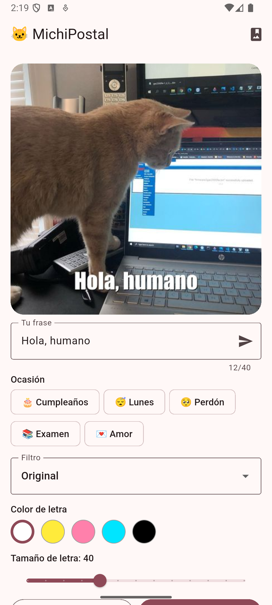 | 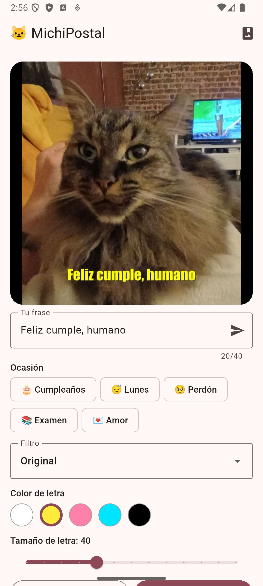 | 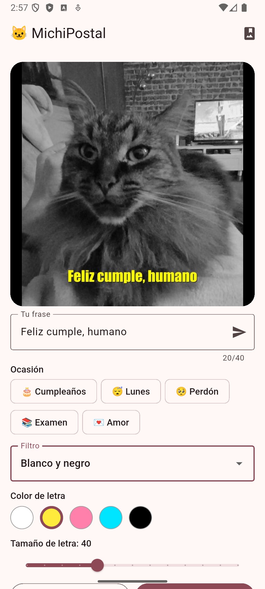 | 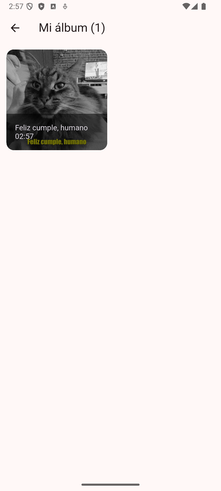 |

### 🧪 Pruebas (`flutter test`)

Archivo: [`michi_postal/test/widget_test.dart`](michi_postal/test/widget_test.dart). Las pruebas usan **repositorios falsos** (sin internet) gracias a la inversión de dependencias.

#### Prueba 1: con id conserva el mismo gato y agrega color y filtro

*Prueba unitaria · grupo: **Construccion de la URL de Cataas (capa de datos)***

```dart
test('con id conserva el mismo gato y agrega color y filtro', () {
  final u = url();
  expect(u, contains('/cat/abc/says/Hola%20humano'));
  expect(u, contains('fontColor=yellow'));
  expect(u, contains('fontSize=40'));
  expect(u, contains('filter=mono'));
});
```

**Salida de `flutter test`:**

```text
00:00 +0: Construccion de la URL de Cataas (capa de datos) con id conserva el mismo gato y agrega color y filtro
✅ PASÓ
```

#### Prueba 2: sin id pide un gato al azar

*Prueba unitaria · grupo: **Construccion de la URL de Cataas (capa de datos)***

```dart
test('sin id pide un gato al azar', () {
  expect(url(id: null), contains('/cat/says/'));
});
```

**Salida de `flutter test`:**

```text
00:00 +1: Construccion de la URL de Cataas (capa de datos) sin id pide un gato al azar
✅ PASÓ
```

#### Prueba 3: frase vacia se convierte en "Miau"

*Prueba unitaria · grupo: **Construccion de la URL de Cataas (capa de datos)***

```dart
test('frase vacia se convierte en "Miau"', () {
  expect(url(frase: '   '), contains('/says/Miau'));
});
```

**Salida de `flutter test`:**

```text
00:00 +2: Construccion de la URL de Cataas (capa de datos) frase vacia se convierte en "Miau"
✅ PASÓ
```

#### Prueba 4: la diagonal "/" se reemplaza para no romper la ruta

*Prueba unitaria · grupo: **Construccion de la URL de Cataas (capa de datos)***

```dart
test('la diagonal "/" se reemplaza para no romper la ruta', () {
  expect(url(frase: 'a/b'), contains('/says/a-b'));
});
```

**Salida de `flutter test`:**

```text
00:00 +3: Construccion de la URL de Cataas (capa de datos) la diagonal "/" se reemplaza para no romper la ruta
✅ PASÓ
```

#### Prueba 5: el filtro "Original" no manda el parametro filter

*Prueba unitaria · grupo: **Construccion de la URL de Cataas (capa de datos)***

```dart
test('el filtro "Original" no manda el parametro filter', () {
  expect(url(filtro: FiltroMichi.original), isNot(contains('filter=')));
});
```

**Salida de `flutter test`:**

```text
00:00 +4: Construccion de la URL de Cataas (capa de datos) el filtro "Original" no manda el parametro filter
✅ PASÓ
```

#### Prueba 6: cada ocasion trae 3 frases sugeridas

*Prueba unitaria · grupo: **Entidades (dominio)***

```dart
test('cada ocasion trae 3 frases sugeridas', () {
  for (final o in Ocasion.values) {
    expect(o.frases.length, 3, reason: o.etiqueta);
  }
});
```

**Salida de `flutter test`:**

```text
00:00 +5: Entidades (dominio) cada ocasion trae 3 frases sugeridas
✅ PASÓ
```

#### Prueba 7: guardar una postal la agrega al album

*Prueba de widget (pantalla) · grupo: **TallerPage (pantalla)***

```dart
testWidgets('guardar una postal la agrega al album', (tester) async {
  tester.view.physicalSize = const Size(1080, 2400);
  tester.view.devicePixelRatio = 1.0;
  addTearDown(tester.view.reset);

  await tester.pumpWidget(MaterialApp(home: TallerPage(repository: RepoFalso())));
  await tester.pumpAndSettle();

  expect(find.text('Tu frase'), findsOneWidget);
  await tester.tap(find.text('Guardar postal'));
  await tester.pump();
  expect(find.text('Postal guardada en tu álbum 📬'), findsOneWidget);
  expect(find.text('1'), findsOneWidget); // contador del álbum
});
```

**Salida de `flutter test`:**

```text
00:00 +6: TallerPage (pantalla) guardar una postal la agrega al album
✅ PASÓ
```

**Resultado completo del archivo:**

```text
00:00 +0: Construccion de la URL de Cataas (capa de datos) con id conserva el mismo gato y agrega color y filtro
00:00 +1: Construccion de la URL de Cataas (capa de datos) sin id pide un gato al azar
00:00 +2: Construccion de la URL de Cataas (capa de datos) frase vacia se convierte en "Miau"
00:00 +3: Construccion de la URL de Cataas (capa de datos) la diagonal "/" se reemplaza para no romper la ruta
00:00 +4: Construccion de la URL de Cataas (capa de datos) el filtro "Original" no manda el parametro filter
00:00 +5: Entidades (dominio) cada ocasion trae 3 frases sugeridas
00:00 +6: TallerPage (pantalla) guardar una postal la agrega al album
00:03 +7: All tests passed!
```

[⬆ Volver al índice](#índice)

<a id="salgo_o_no"></a>

## Reto 3 · ¿Salgo o no? ☁️

**API:** OpenWeatherMap + geolocator  ·  **Carpeta:** [`salgo_o_no/`](salgo_o_no/)

Además del clima actual, eliges tu **plan** (correr, bici, tender ropa, tacos en la calle, lavar el coche, picnic) y un caso de uso da un **veredicto tipo semáforo** (0–100) con las razones.

### 📱 Capturas en el emulador

| Clima actual de la ciudad con su veredicto | Veredicto para otro plan | Búsqueda de otra ciudad |
|---|---|---|
| 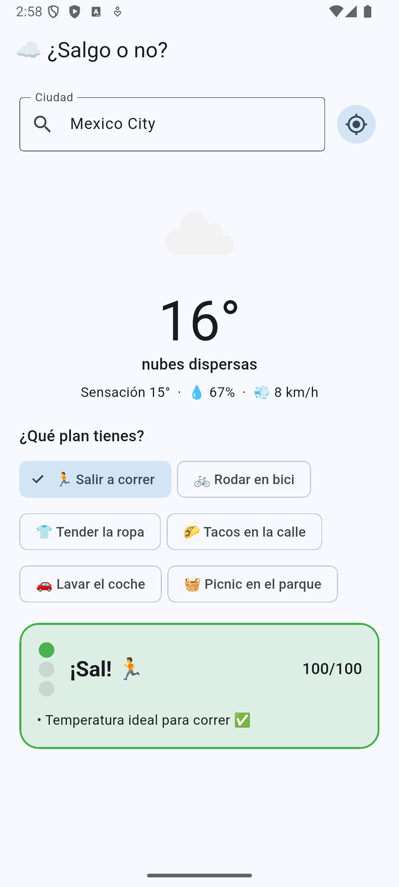 | 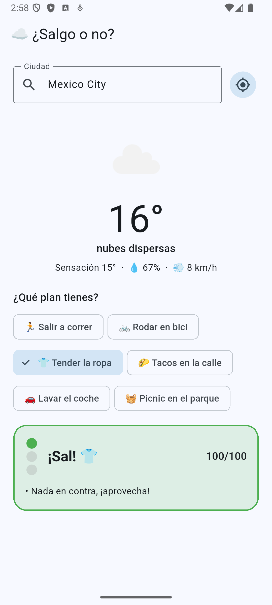 | 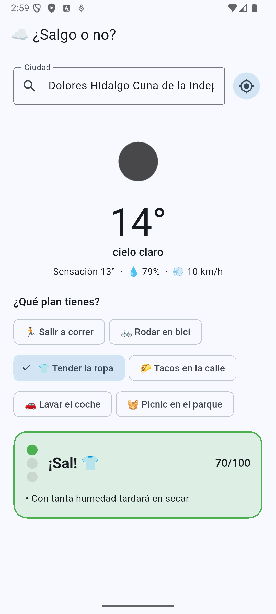 |

### 🧪 Pruebas (`flutter test`)

Archivo: [`salgo_o_no/test/widget_test.dart`](salgo_o_no/test/widget_test.dart). Las pruebas usan **repositorios falsos** (sin internet) gracias a la inversión de dependencias.

#### Prueba 1: 15 grados, despejado y sin viento: correr da verde y 100 puntos

*Prueba unitaria · grupo: **EvaluarPlan (caso de uso)***

```dart
test('15 grados, despejado y sin viento: correr da verde y 100 puntos', () {
  final v = evaluar(clima(), Plan.correr);
  expect(v.semaforo, Semaforo.verde);
  expect(v.puntaje, 100);
});
```

**Salida de `flutter test`:**

```text
00:00 +0: EvaluarPlan (caso de uso) 15 grados, despejado y sin viento: correr da verde y 100 puntos
✅ PASÓ
```

#### Prueba 2: con lluvia no conviene tender la ropa (rojo)

*Prueba unitaria · grupo: **EvaluarPlan (caso de uso)***

```dart
test('con lluvia no conviene tender la ropa (rojo)', () {
  final v = evaluar(clima(humedad: 90, codigo: 501), Plan.tender);
  expect(v.semaforo, Semaforo.rojo);
});
```

**Salida de `flutter test`:**

```text
00:00 +1: EvaluarPlan (caso de uso) con lluvia no conviene tender la ropa (rojo)
✅ PASÓ
```

#### Prueba 3: viento de 45 km/h en bici resta 60 puntos (amarillo)

*Prueba unitaria · grupo: **EvaluarPlan (caso de uso)***

```dart
test('viento de 45 km/h en bici resta 60 puntos (amarillo)', () {
  final v = evaluar(clima(viento: 45), Plan.bici);
  expect(v.puntaje, 40);
  expect(v.semaforo, Semaforo.amarillo);
});
```

**Salida de `flutter test`:**

```text
00:00 +2: EvaluarPlan (caso de uso) viento de 45 km/h en bici resta 60 puntos (amarillo)
✅ PASÓ
```

#### Prueba 4: el puntaje nunca baja de 0 aunque haya tormenta

*Prueba unitaria · grupo: **EvaluarPlan (caso de uso)***

```dart
test('el puntaje nunca baja de 0 aunque haya tormenta', () {
  final v = evaluar(clima(codigo: 211), Plan.picnic);
  expect(v.puntaje, 0);
  expect(v.razones, contains('Hay tormenta eléctrica ⛈️'));
});
```

**Salida de `flutter test`:**

```text
00:00 +3: EvaluarPlan (caso de uso) el puntaje nunca baja de 0 aunque haya tormenta
✅ PASÓ
```

#### Prueba 5: los codigos de OpenWeatherMap se interpretan bien

*Prueba unitaria · grupo: **Clima (entidad) y ClimaModel (datos)***

```dart
test('los codigos de OpenWeatherMap se interpretan bien', () {
  expect(clima(codigo: 804).muyNublado, isTrue);
  expect(clima(codigo: 800).despejado, isTrue);
  expect(clima(codigo: 302).mojado, isTrue);
});
```

**Salida de `flutter test`:**

```text
00:00 +4: Clima (entidad) y ClimaModel (datos) los codigos de OpenWeatherMap se interpretan bien
✅ PASÓ
```

#### Prueba 6: convierte el viento de m/s a km/h al leer el JSON

*Prueba unitaria · grupo: **Clima (entidad) y ClimaModel (datos)***

```dart
test('convierte el viento de m/s a km/h al leer el JSON', () {
  final m = ClimaModel.fromJson({
    'name': 'Dolores Hidalgo',
    'main': {'temp': 24.5, 'feels_like': 25, 'humidity': 40},
    'wind': {'speed': 10},
    'weather': [
      {'id': 801, 'description': 'algo de nubes', 'icon': '02d'}
    ],
  });
  expect(m.ciudad, 'Dolores Hidalgo');
  expect(m.vientoKmh, closeTo(36, 1e-9));
  expect(m.codigo, 801);
});
```

**Salida de `flutter test`:**

```text
00:00 +5: Clima (entidad) y ClimaModel (datos) convierte el viento de m/s a km/h al leer el JSON
✅ PASÓ
```

#### Prueba 7: muestra la temperatura y el veredicto del plan

*Prueba de widget (pantalla) · grupo: **ClimaPage (pantalla)***

```dart
testWidgets('muestra la temperatura y el veredicto del plan', (tester) async {
  tester.view.physicalSize = const Size(1080, 2400);
  tester.view.devicePixelRatio = 1.0;
  addTearDown(tester.view.reset);

  await tester.pumpWidget(MaterialApp(
    home: ClimaPage(repository: RepoFalso(), evaluar: EvaluarPlan()),
  ));
  await tester.pumpAndSettle();

  expect(find.text('22°'), findsOneWidget);
  expect(find.text('100/100'), findsOneWidget);

  await tester.tap(find.text('👕 Tender la ropa'));
  await tester.pumpAndSettle();
  expect(find.textContaining('/100'), findsOneWidget);
});
```

**Salida de `flutter test`:**

```text
00:00 +6: ClimaPage (pantalla) muestra la temperatura y el veredicto del plan
✅ PASÓ
```

**Resultado completo del archivo:**

```text
00:00 +0: EvaluarPlan (caso de uso) 15 grados, despejado y sin viento: correr da verde y 100 puntos
00:00 +1: EvaluarPlan (caso de uso) con lluvia no conviene tender la ropa (rojo)
00:00 +2: EvaluarPlan (caso de uso) viento de 45 km/h en bici resta 60 puntos (amarillo)
00:00 +3: EvaluarPlan (caso de uso) el puntaje nunca baja de 0 aunque haya tormenta
00:00 +4: Clima (entidad) y ClimaModel (datos) los codigos de OpenWeatherMap se interpretan bien
00:00 +5: Clima (entidad) y ClimaModel (datos) convierte el viento de m/s a km/h al leer el JSON
00:00 +6: ClimaPage (pantalla) muestra la temperatura y el veredicto del plan
00:01 +7: All tests passed!
```

[⬆ Volver al índice](#índice)

<a id="alcancia_cripto"></a>

## Reto 4 · Alcancía Cripto 🐷

**API:** CoinGecko  ·  **Carpeta:** [`alcancia_cripto/`](alcancia_cripto/)

Escribe cuántos dólares hay en tu alcancía y ve cuánto **BTC, ETH y SOL** compras, también en **satoshis, gwei y lamports**, más una **“máquina del tiempo de 24 h”**: cuánto tendrías hoy si hubieras comprado ayer.

### 📱 Capturas en el emulador

| Precios en tiempo real y conversión de $50 USD | Recalculo instantáneo con el botón de $500 |
|---|---|
| 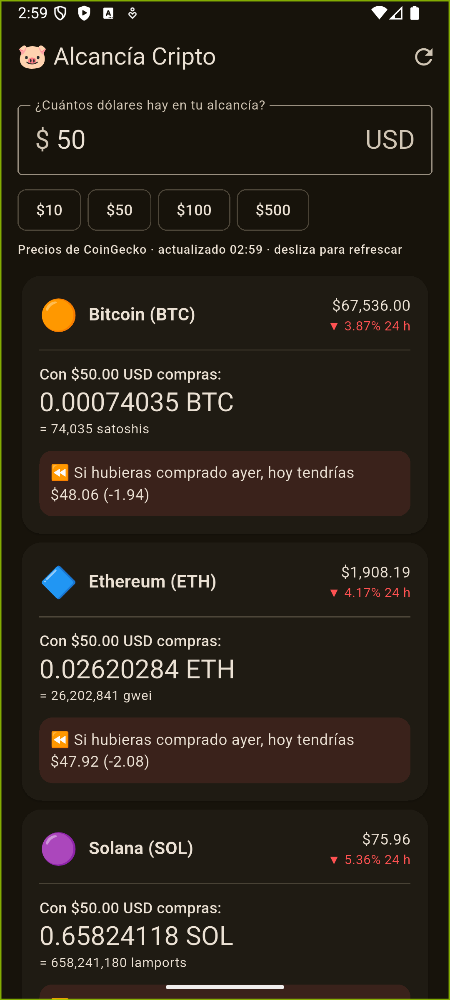 | 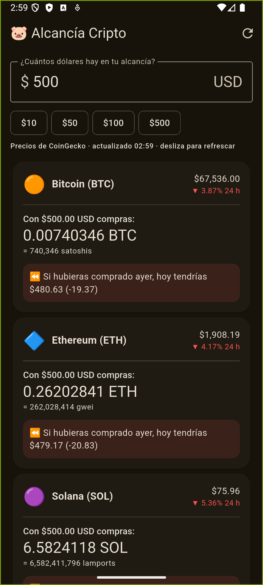 |

### 🧪 Pruebas (`flutter test`)

Archivo: [`alcancia_cripto/test/widget_test.dart`](alcancia_cripto/test/widget_test.dart). Las pruebas usan **repositorios falsos** (sin internet) gracias a la inversión de dependencias.

#### Prueba 1: con 100 USD y BTC a 50,000 se compran 0.002 BTC = 200,000 satoshis

*Prueba unitaria · grupo: **CalcularCompra (caso de uso)***

```dart
test('con 100 USD y BTC a 50,000 se compran 0.002 BTC = 200,000 satoshis', () {
  final compra = CalcularCompra()(moneda(), 100);
  expect(compra.cantidad, closeTo(0.002, 1e-12));
  expect(compra.cantidadUnidadMinima, closeTo(200000, 1e-6));
});
```

**Salida de `flutter test`:**

```text
00:00 +0: CalcularCompra (caso de uso) con 100 USD y BTC a 50,000 se compran 0.002 BTC = 200,000 satoshis
✅ PASÓ
```

#### Prueba 2: maquina del tiempo: si subio 10% en 24 h, 100 USD de ayer hoy valen 110

*Prueba unitaria · grupo: **CalcularCompra (caso de uso)***

```dart
test('maquina del tiempo: si subio 10% en 24 h, 100 USD de ayer hoy valen 110', () {
  final compra = CalcularCompra()(moneda(precio: 110, cambio: 10), 100);
  expect(compra.valorHoySiCompraAyer, closeTo(110, 1e-9));
  expect(compra.diferencia, closeTo(10, 1e-9));
});
```

**Salida de `flutter test`:**

```text
00:00 +1: CalcularCompra (caso de uso) maquina del tiempo: si subio 10% en 24 h, 100 USD de ayer hoy valen 110
✅ PASÓ
```

#### Prueba 3: si el precio llega en 0 no truena: la cantidad es 0

*Prueba unitaria · grupo: **CalcularCompra (caso de uso)***

```dart
test('si el precio llega en 0 no truena: la cantidad es 0', () {
  final compra = CalcularCompra()(moneda(precio: 0), 100);
  expect(compra.cantidad, 0);
});
```

**Salida de `flutter test`:**

```text
00:00 +2: CalcularCompra (caso de uso) si el precio llega en 0 no truena: la cantidad es 0
✅ PASÓ
```

#### Prueba 4: dinero agrega comas de miles y 2 decimales

*Prueba unitaria · grupo: **Formato (core)***

```dart
test('dinero agrega comas de miles y 2 decimales', () {
  expect(Formato.dinero(1234567.891), '1,234,567.89');
  expect(Formato.dinero(-1500), '-1,500.00');
});
```

**Salida de `flutter test`:**

```text
00:00 +3: Formato (core) dinero agrega comas de miles y 2 decimales
✅ PASÓ
```

#### Prueba 5: cripto quita los ceros que sobran

*Prueba unitaria · grupo: **Formato (core)***

```dart
test('cripto quita los ceros que sobran', () {
  expect(Formato.cripto(0.002), '0.002');
  expect(Formato.cripto(1), '1');
});
```

**Salida de `flutter test`:**

```text
00:00 +4: Formato (core) cripto quita los ceros que sobran
✅ PASÓ
```

#### Prueba 6: lee el JSON de CoinGecko /simple/price

*Prueba unitaria · grupo: **CriptoModel (capa de datos)***

```dart
test('lee el JSON de CoinGecko /simple/price', () {
  final m = CriptoModel.fromJson('ethereum', {'usd': 3000, 'usd_24h_change': -2.5});
  expect(m.simbolo, 'ETH');
  expect(m.unidadMinima, 'gwei');
  expect(m.precioUsd, 3000.0);
  expect(m.cambio24h, -2.5);
});
```

**Salida de `flutter test`:**

```text
00:00 +5: CriptoModel (capa de datos) lee el JSON de CoinGecko /simple/price
✅ PASÓ
```

#### Prueba 7: muestra la moneda y recalcula al escribir otro monto

*Prueba de widget (pantalla) · grupo: **AlcanciaPage (pantalla)***

```dart
testWidgets('muestra la moneda y recalcula al escribir otro monto', (tester) async {
  await tester.pumpWidget(MaterialApp(
    home: AlcanciaPage(repository: RepoFalso(), calcular: CalcularCompra()),
  ));
  await tester.pumpAndSettle();

  expect(find.text('Bitcoin (BTC)'), findsOneWidget);
  expect(find.text('Con \$50.00 USD compras:'), findsOneWidget);

  await tester.enterText(find.byType(TextField), '200');
  await tester.pump();
  expect(find.text('Con \$200.00 USD compras:'), findsOneWidget);
  expect(find.text('0.004 BTC'), findsOneWidget);
});
```

**Salida de `flutter test`:**

```text
00:00 +6: AlcanciaPage (pantalla) muestra la moneda y recalcula al escribir otro monto
✅ PASÓ
```

**Resultado completo del archivo:**

```text
00:00 +0: CalcularCompra (caso de uso) con 100 USD y BTC a 50,000 se compran 0.002 BTC = 200,000 satoshis
00:00 +1: CalcularCompra (caso de uso) maquina del tiempo: si subio 10% en 24 h, 100 USD de ayer hoy valen 110
00:00 +2: CalcularCompra (caso de uso) si el precio llega en 0 no truena: la cantidad es 0
00:00 +3: Formato (core) dinero agrega comas de miles y 2 decimales
00:00 +4: Formato (core) cripto quita los ceros que sobran
00:00 +5: CriptoModel (capa de datos) lee el JSON de CoinGecko /simple/price
00:00 +6: AlcanciaPage (pantalla) muestra la moneda y recalcula al escribir otro monto
00:01 +7: All tests passed!
```

[⬆ Volver al índice](#índice)

<a id="como-ejecutar"></a>

## ▶️ Cómo ejecutar

```bash
cd peli_voto              # o michi_postal, salgo_o_no, alcancia_cripto
flutter pub get
flutter test -r expanded  # corre las pruebas
flutter run               # Alcancía Cripto y MichiPostal no necesitan key
flutter run --dart-define=TMDB_KEY=TU_KEY   # PeliVoto
flutter run --dart-define=OWM_KEY=TU_KEY    # ¿Salgo o no?
```

Las API keys **no están en el código**: se pasan con `--dart-define` al ejecutar.

## 🗂️ Estructura (ejemplo con PeliVoto)

```
lib/
├── core/config.dart                       # configuración global (API key por --dart-define)
├── main.dart                              # inyección de dependencias manual
└── features/votacion/
    ├── data/        (datasources, models, repositories impl)
    ├── domain/      (entities, repositories abstractos, usecases)  ← Dart puro
    └── presentation/(pages, widgets)
test/widget_test.dart                      # pruebas unitarias y de widget
```
